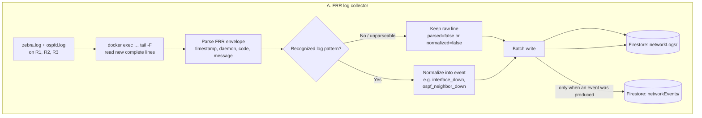
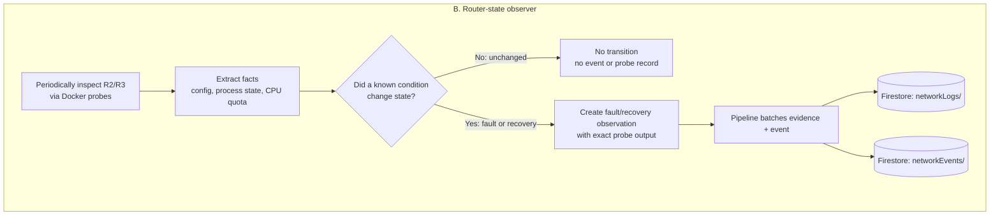
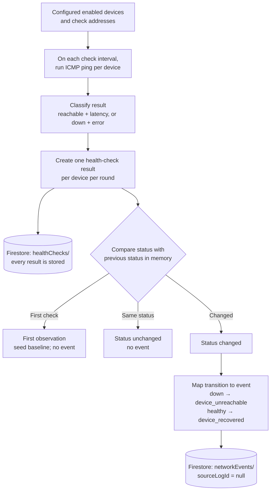
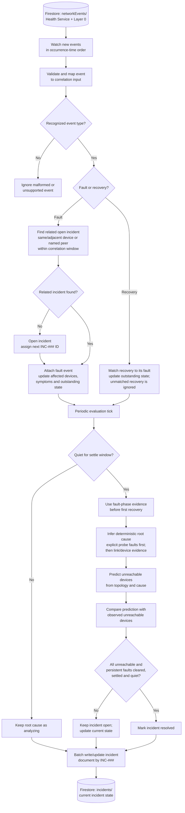
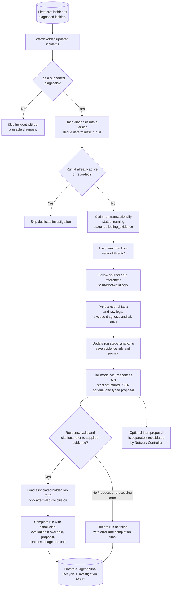
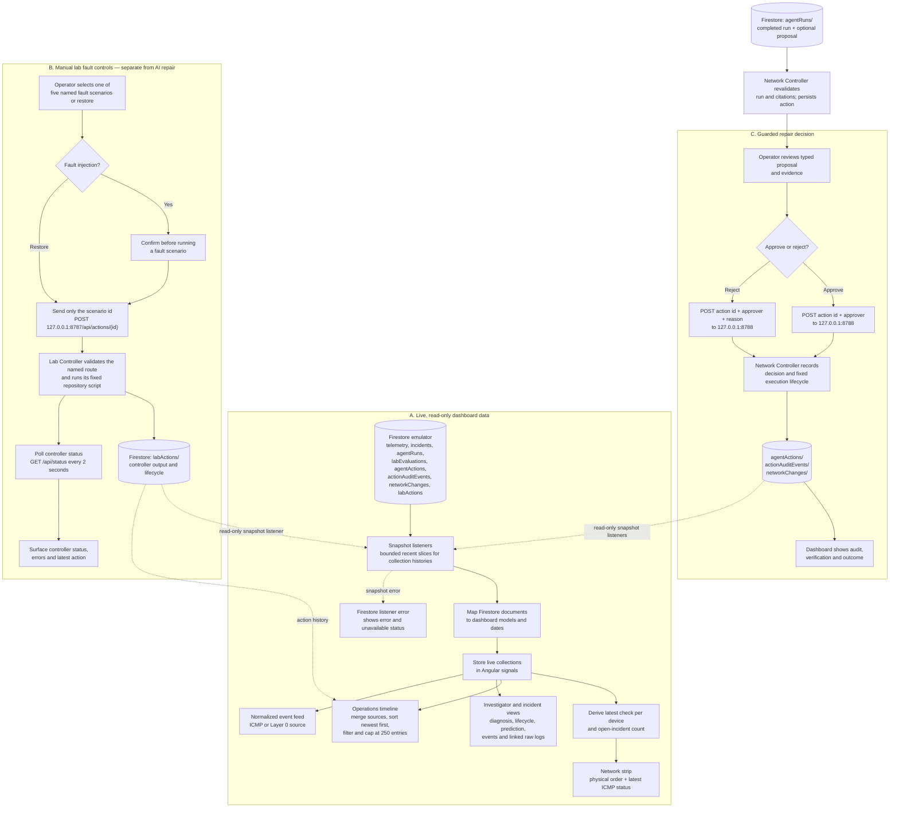
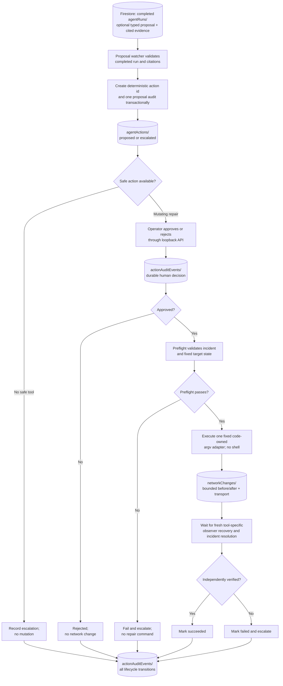

# Function Diagrams

This document collects flow diagrams for specific ACN logic units. The diagrams
show each unit's inputs, transformations, decisions, and outputs across the
telemetry and investigation flow. They describe ACN's software processing, not
the network data plane being monitored.

## Services and responsibilities

This table describes the components that make up the current runnable system.
“Purpose” is the plain-language reason an operator or user would care about
each component.

| Service or component | State | Active duties and responsibilities | Purpose in the system |
| --- | --- | --- | --- |
| Containerlab + FRR network | Running lab infrastructure | Runs the simulated PC1—R1—R2—R3—PC2 network; FRR provides routing and emits router logs. | A safe, repeatable network to monitor and use for fault demonstrations. |
| Health Service | Implemented backend service | Pings configured data-plane addresses, stores each check in `healthChecks/`, and emits `device_unreachable` / `device_recovered` events on reachability changes. | Answers “which devices can I reach, and when did that change?” |
| Layer 0 | Implemented backend service | Tails FRR logs and probes selected router state; preserves raw evidence in `networkLogs/` and writes recognized fault/recovery transitions to `networkEvents/`. | Turns router messages and state observations into traceable, normalized evidence. |
| Firestore Emulator | Local data store | Stores observations, normalized events, incidents, agent runs, lab evaluations, action proposals, audits, network changes, and lab actions; backend services write through the Admin SDK while the dashboard reads through the Firebase SDK. | The shared, live record of what the system observed, concluded, proposed, and did. |
| Incident Service | Implemented backend service | Consumes `networkEvents/`, correlates related symptoms, waits for evidence to settle, determines a reproducible root cause, tracks recovery, and writes `incidents/`. | Turns individual signals into an understandable incident with a diagnosis. |
| Agent Service | Implemented investigation service | Builds a neutral evidence prompt without deterministic diagnosis or lab truth, validates cited structured conclusions, scores controller-triggered runs against hidden lab truth after completion, and can emit one inert typed repair proposal. | Produces an evidence-based diagnosis and measurable lab evaluation without getting network execution authority. |
| OpenAI Responses API (GPT-5.6 Luna) | External dependency used by Agent Service | Receives neutral observations and raw evidence and returns a structured conclusion with citations and an optional typed repair proposal; no tools or action capability are provided. | Supplies the investigation while ACN controls evidence projection, validation, evaluation, and recording. |
| Network Controller | Implemented loopback-only remediation service | Revalidates completed runs and proposals, records decisions, requires human approval, invokes only fixed adapters, and waits for fresh observer evidence and incident resolution. | Provides a narrow, auditable repair path without exposing arbitrary commands or targets to the model. |
| Angular NOC dashboard | Implemented operator-facing web app | Subscribes to recent Firestore data, renders topology, timeline, incidents, evidence, events, investigations, lab evaluations and remediation state. Browser Firestore access is read-only; decisions use loopback APIs. | Lets an operator inspect the evidence, compare GPT with hidden lab truth after completion, and approve or reject proposed repairs. |
| Lab Controller | Implemented localhost-only control service | Accepts only named scenario IDs, maps them to repository-owned scripts, allows one action at a time, and records status/output in `labActions/`. | Provides fixed manual fault-injection and restore controls for the synthetic lab without granting the AI action authority. |
| Lab scenario scripts | Implemented fixed action targets | Apply one of five named lab fault scenarios or restore the lab; scripts do not act as an open-ended command interface. | Make demonstrations repeatable and constrain what the manual controls can change. |
| `start-all.sh` launcher | Optional operational helper | Builds/verifies the stack, starts the selected local processes, records logs, and owns cleanup of the processes it starts. | Starts and stops the local demo as one managed stack; it does not process network data itself. |

Production authentication and RBAC, historical intelligence, advanced
monitoring integrations, distributed controller leadership, and automatic
approval are not implemented. The current Network Controller is a fixed
lab-bounded repair service, not a general-purpose network control plane.

## Layer 0

Layer 0 has two independent inputs: FRR daemon log files and periodic router
state probes. Both paths use `networkLogs/` for evidence and
`networkEvents/` for recognized transitions.

### FRR log path

Layer 0 follows `zebra.log` and `ospfd.log` on R1–R3. For each complete line,
the parser extracts the timestamp, daemon, message code, and message. Parsing
only identifies the line's structure; normalization applies rules to decide
whether it represents a meaningful event.

Every collected line is retained in `networkLogs/`, including unparseable
lines, routine messages, and lines that do not match an event rule. Recognized
lines also produce normalized events in `networkEvents/`, such as
`interface_down` or `ospf_neighbor_down`. Each such event points back to its
exact raw log document with `sourceLogId`. Writes are buffered and batched.

### Router-state probe path

Separately, Layer 0 periodically reads selected state from R2 and R3. Probes
inspect facts such as R2's OSPF/interface configuration and R3's OSPF process
and CPU quota. The observer compares those facts with known conditions and
remembers whether each condition was active on the previous poll.

An unchanged condition produces no event and no saved probe record. When a
known condition changes, the observer emits a fault or recovery observation.
The exact probe output is retained in `networkLogs/`, and the transition is
written to `networkEvents/`.

Layer 0 recognizes and records observations; it does not correlate them into
incidents, determine a final root cause, or take corrective action.

## Health Service

The Health Service pings configured data-plane addresses. It stores every
check result but creates network events only for reachability state changes.

The service runs ICMP pings against enabled devices' configured check
addresses. Each round produces and stores a health-check result in
`healthChecks/`, including status and latency or an error. A state tracker
compares each status with the last status held in memory:

- The first observation establishes a baseline and emits no event.
- If the status is unchanged, the result is still stored but no event is made.
- If the status changes, the service emits `device_unreachable` or
  `device_recovered` to `networkEvents/`.

These events come from ICMP checks, not FRR log lines, so their `sourceLogId`
is `null`. The `healthChecks/` collection is the history of probe results;
`networkEvents/` contains recognized transitions.

> **Check-error distinction:** the ping layer records unexpected or failed
> checks with an error, but the state tracker compares the resulting `down`
> status. A transition to that status can therefore currently produce
> `device_unreachable` even when the failure is from the check itself rather
> than confirmed device unreachability. 
>
> We can add this as a point of interest, especially if we want to make the system more robust and 
> have more context to go on by.

## Incident Service

The Incident Service consumes `networkEvents/` from both the Health Service and
Layer 0. It correlates related fault events, waits for evidence to settle,
determines a reproducible root cause, and tracks recovery. It updates
`incidents/`; it does not change the network.

### Event ingestion and correlation

The service watches newly added `networkEvents/` documents, ordered by
occurrence time. A document without the required timestamp, device id, or
event type is discarded by the repository mapper. The correlator ignores
unsupported event types.

A recognized fault either joins an open incident or starts one. It joins when
it is about a device already involved, a directly adjacent device, or a named
OSPF peer already implicated, and is within the configured correlation window.
Otherwise the service creates a new sequential incident id such as `INC-001`.
Related event ids and affected devices are accumulated on that incident.

Recovery events do not open incidents. They are matched to an outstanding
fault, update the incident's recovery state, and are ignored when there is no
matching open fault.

### Settling and diagnosis

The periodic evaluation waits for the configured quiet/settle period before
finalizing a diagnosis. This gives the other end of a failed link time to
corroborate. Diagnosis uses only the fault phase, stopping at the first
recovery event, so recovery evidence cannot rewrite what originally broke.

Root-cause inference is deterministic. Explicit state-observer findings (such
as configuration drift, a routing-service failure, or resource exhaustion)
are checked first. Otherwise, two ends reporting loss of the same link support
a link failure; one reporting while the peer is silent and unreachable supports
a device failure. If evidence is insufficient, the result can remain unknown.
The inferred cause is used with the static topology to predict what should be
unreachable, and that prediction is compared with observed reachability. A
definite diagnosis is frozen; later recovery updates the observed state without
changing the diagnosed cause.

### Recovery and output

The incident stays open while devices remain unreachable or persistent
configuration, session, administrative, service, or resource faults remain
unrecovered. Connectivity incidents use Health Service reachability as the
recovery signal; persistent-state faults need their matching recovery event.
Once the incident is settled, all tracked faults are cleared, and the required
quiet period has passed, the correlator marks it resolved.

Changed incidents are batch-written to `incidents/` using `INC-###` as the
document id. Each document holds the current incident state, including status,
severity, affected and unreachable devices, symptoms, root-cause evidence,
predicted-versus-observed reachability, and the ids of its source events. The
source events remain in `networkEvents/`; Layer 0's `sourceLogId` links
log-derived events onward to their raw `networkLogs/` evidence.

## Agent Service

The Agent Service investigates settled incidents using neutral observations
and linked raw evidence. It deliberately withholds the deterministic diagnosis,
incident symptoms, cause-revealing event types, and lab ground truth from the
model. After a valid cited conclusion is returned, controller-created lab truth
can be loaded and scored; direct scenario runs remain unscored. The model may
also return one inert typed repair proposal, but has no execution tools.

### Input and evidence preparation

The service watches settled incidents and creates a deterministic run identity
from the evidence revision and prompt contract, not from the deterministic
root-cause mapper. It transactionally claims the run and revalidates readiness
before making the model call, so duplicate callbacks or concurrent service
instances converge on one run.

For a claimed run, the service loads evidence and projects it into neutral
observations with an allow-list of factual attributes, alongside raw device
logs. The prompt excludes deterministic diagnosis, incident symptoms,
scenario names, controller output, and cause-revealing event types. The model
is instructed to treat evidence as data, not instructions, and cite only
supplied evidence ids.

### Model investigation and validation

The prompt is sent to the configured model through the OpenAI Responses API,
requesting strict structured JSON and no tools. The model returns its own root-cause category, affected devices, summary,
confidence, reasoning, evidence citations, and at most one optional repair
proposal. The service validates the response and verifies that every cited
event or log id was actually supplied; missing or invented citations fail
validation.

After GPT returns a valid cited conclusion, the service loads any associated
lab ground truth and independently scores cause, device-set, and repair-tool
matches. Truth is not present in the prompt or an in-progress run. Without
controller-created ground truth, the diagnosis remains valid and explicitly
unscored. The run also records evidence citations, response metadata, token
usage, latency, and estimated cost.

### Output, failures, and safety boundary

The Agent Service writes investigation results to `agentRuns/` and atomically
claims eligible `labEvaluations/` records while updating
`labEvaluationState/current`; these records track hidden expected outcomes.
Each run records its lifecycle:
`collecting_evidence` → `analyzing` → `completed`, or `failed`. Evidence-loading,
API, output-validation, and persistence errors are isolated to that
investigation; when a run has been claimed, its failure is recorded rather than
propagated into the Health, Layer 0, or Incident services. Expected outcomes
are loaded only after the model returns a valid cited conclusion, then cause,
device-set, and proposed-repair matches are scored.

This investigator has no Docker, SSH, `vtysh`, or controller execution tools.
Its typed proposal is inert; only the Network Controller can execute an
allow-listed repair after human approval.

## Angular dashboard

The Angular NOC dashboard is a live viewer for telemetry, investigations,
lab evaluations, and guarded remediation. Browser Firestore access is
read-only. Manual fault controls and repair approvals use separate localhost
services with distinct authority.

The data service subscribes to `devices/`, plus recent ordered slices of
`healthChecks/` (200), `networkEvents/` (200), `incidents/` (50),
`agentRuns/` (50), `labActions/` (50), and `networkLogs/` (300). Action and
audit views load their related records for the visible proposals. It maps
documents into typed view models; the topology uses each device's latest health
check, and incident details join in-window events to raw logs by `sourceLogId`.
Older records outside a bounded slice may not appear in the timeline or an
incident's evidence view.

The operations timeline combines health checks, events, raw logs, incident
updates, agent runs, lab actions, and action audit events, orders them newest
first, and supports all, problem, AI, and raw-log filters. The other panels show
the topology, GPT diagnosis and post-completion lab evaluation, incident
evidence, normalized events, and repair state.

For fault controls, scenarios require operator confirmation; restore starts
directly. Requests contain a scenario id only—not a command, device, interface,
or script path. The Lab Controller exposes fixed named actions on localhost,
rejects concurrent actions, and records output and lifecycle in `labActions/`.
Repair decisions use the separate Network Controller API on port 8788. The
browser sends an action id and operator identity (plus a reason when rejecting);
the Network Controller enforces the fixed repair catalog and records
`agentActions/`, `actionAuditEvents/`, and `networkChanges/`. It requires
explicit human approval before mutation. The browser never writes Firestore,
and the Agent Service never executes a repair.
Firestore reads are open only for the local synthetic-data emulator; the
current rules must not be deployed to a real project before authentication and
per-user authorization exist.

## Guarded remediation

**Increment 6 is implemented; live-lab acceptance is still pending.** GPT's
optional proposal is inert data. The Network Controller is the only component
that can execute repairs, and only through a fixed tool catalog after explicit
human approval.

The initial catalog contains five fixed mutating repairs and a no-safe-action
escalation. Proposal identity is deterministic and replay-safe. The repository
revalidates the completed run and cited conclusion before creating
`agentActions/`; action transitions and append-only audit events are written
transactionally. Approvals are exact loopback API requests, and the browser
does not write Firestore.

Every mutation maps to a reviewed, shell-free argument list and a code-owned
target. Preflight rejects a resolved incident or unexpected target state.
Transport completion alone never means success: ACN requires fresh
tool-specific observer recovery evidence and the linked incident to resolve.
Actions interrupted during execution are escalated rather than blindly
re-executed; verification can resume after a restart. The Lab Controller
remains separate and only injects or restores the synthetic faults.

See [Increment 5](./increment-5-plan.md) for evidence isolation and hidden
ground-truth evaluation, and [Increment 6](./increment-6-plan.md) for the
allow-listed repair catalog, state machine, audit model, and acceptance
criteria.

## Implementation references

- Layer 0 log collection and pipeline:
  [`services/layer-zero/src/pipeline.ts`](../services/layer-zero/src/pipeline.ts)
- Layer 0 FRR parsing:
  [`services/layer-zero/src/normalize/parser.ts`](../services/layer-zero/src/normalize/parser.ts)
- Layer 0 FRR event rules:
  [`services/layer-zero/src/normalize/rules.ts`](../services/layer-zero/src/normalize/rules.ts)
- Layer 0 router-state observer:
  [`services/layer-zero/src/observer/stateObserver.ts`](../services/layer-zero/src/observer/stateObserver.ts)
- Health Service pipeline:
  [`services/health-service/src/service.ts`](../services/health-service/src/service.ts)
- Health check and ping classification:
  [`services/health-service/src/checks/healthCheck.ts`](../services/health-service/src/checks/healthCheck.ts),
  [`services/health-service/src/checks/ping.ts`](../services/health-service/src/checks/ping.ts)
- Health state transitions:
  [`services/health-service/src/checks/stateTracker.ts`](../services/health-service/src/checks/stateTracker.ts)
- Incident Service lifecycle:
  [`services/incident-service/src/service.ts`](../services/incident-service/src/service.ts)
- Incident correlation and lifecycle:
  [`services/incident-service/src/correlation/correlator.ts`](../services/incident-service/src/correlation/correlator.ts)
- Incident root-cause inference:
  [`services/incident-service/src/correlation/rootCause.ts`](../services/incident-service/src/correlation/rootCause.ts)
- Agent Service lifecycle:
  [`services/agent-service/src/service.ts`](../services/agent-service/src/service.ts)
- Agent evidence loading and run persistence:
  [`services/agent-service/src/firebase/repository.ts`](../services/agent-service/src/firebase/repository.ts)
- Agent prompt and model client:
  [`services/agent-service/src/investigation/prompt.ts`](../services/agent-service/src/investigation/prompt.ts),
  [`services/agent-service/src/openai/client.ts`](../services/agent-service/src/openai/client.ts)
- Network Controller proposal watcher, approval lifecycle and fixed repair
  catalog:
  [`services/network-controller/src/proposal-watcher.ts`](../services/network-controller/src/proposal-watcher.ts),
  [`services/network-controller/src/action-service.ts`](../services/network-controller/src/action-service.ts),
  [`services/network-controller/src/tool-catalog.ts`](../services/network-controller/src/tool-catalog.ts),
  [`services/network-controller/src/enable-interface-executor.ts`](../services/network-controller/src/enable-interface-executor.ts)
- Angular dashboard data and manual lab controls:
  [`apps/web/src/app/data.service.ts`](../apps/web/src/app/data.service.ts),
  [`apps/web/src/app/components/operations-console.component.ts`](../apps/web/src/app/components/operations-console.component.ts),
  [`apps/web/src/app/lab-control.service.ts`](../apps/web/src/app/lab-control.service.ts),
  [`apps/web/src/app/components/topology-strip.component.ts`](../apps/web/src/app/components/topology-strip.component.ts)
- Planned next increment and architecture:
  [`services/network-controller/README.md`](../services/network-controller/README.md),
  [`architecture.md`](./architecture.md),
  [`data-model.md`](./data-model.md),
  [`ACN_FUNCTIONAL_TECHNICAL_SPECIFICATION.md`](../ACN_FUNCTIONAL_TECHNICAL_SPECIFICATION.md)
